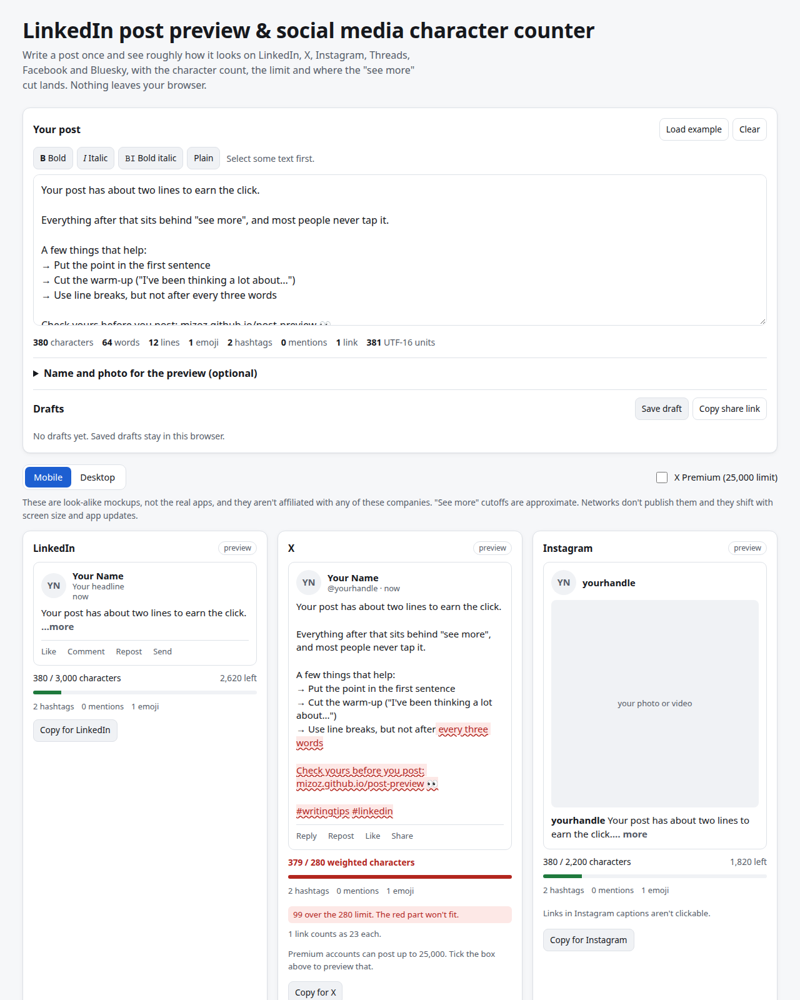

# Post Preview

**Live: https://lab.zalastack.com/post-preview/**

Write a post once and see it as a LinkedIn, X, Instagram, Threads, Facebook and Bluesky post side by side, with the character count against each limit and roughly where the "see more" cut lands.



I built this because I kept writing LinkedIn posts where the actual point landed right after "…more", and kept pasting the same text into three different counters that all disagreed on how many characters an emoji is. So this one does all of it in one place.

## What it does

- Previews for six networks, side by side, mobile or desktop width. They're look-alike mockups, not the real apps.
- Character count vs each network's 2026 limit, with the overflow highlighted in red.
- X uses its real weighted count: emoji and CJK count as 2, every link counts as 23. Same rules as X's open-source twitter-text library (the tests compare against it).
- Threads counts each emoji as its UTF-8 bytes (usually 4), going by the Threads developer docs.
- Everywhere else, emoji are counted the way you see them, so a family or a flag is 1, not 7.
- Shows where "see more" cuts the post on mobile and desktop. These are approximate (see below).
- Hook checker: the exact text people see before the cut, per network.
- Hashtag, mention, link and emoji counts, plus warnings (Instagram's 5 hashtag cap, Threads' one tag, X links = 23, and so on).
- Unicode bold / italic styling for selected text, with a warning, because screen readers really struggle with it.
- Optional name, handle and photo for the previews.
- Drafts saved in your browser, copy per network, and a share link.

## Privacy

Everything runs in your browser. No accounts, no analytics, no cookies, nothing sent anywhere. Drafts, your name and the photo are saved in localStorage on your machine. The share link keeps the text after the `#`, which browsers don't send to the server.

## How the "see more" cut works

None of the networks publish this, and it moves with screen width, font size and app version. I model it as a character budget plus a line budget (with a rough characters-per-line for each width), whichever runs out first, and then back up to the last space. Numbers I used:

| Network | Mobile | Desktop |
|---|---|---|
| LinkedIn | ~140 chars or 3 lines | ~210 chars or 3 lines |
| Instagram | ~125 chars or 2 lines | ~125 chars or 2 lines |
| Facebook | ~125 chars or 5 lines | ~477 chars or 6 lines |
| X Premium long posts | ~280 chars | ~280 chars |
| X (normal), Threads, Bluesky | no fold | no fold |

Treat these as close, not exact. If you see something different on your phone, open an issue.

## The X count

X's weighting is implemented properly (code point ranges, emoji as 2, NFC normalization, URLs as 23). The one approximation: twitter-text recognizes bare links like `example.com` against the full list of domain endings, and I only check common ones (.com, .ca, .io, .org, .co, .app and so on). Links with `https://` always count right.

## Run it locally

No build step.

```
python3 -m http.server
```

Then open http://localhost:8000. Tests for the counting code: `node test/count.test.js`.

## Sources

Last checked 2026-10-21.

- X character counting: https://docs.x.com/fundamentals/counting-characters and the twitter-text config (v3) https://github.com/twitter/twitter-text
- X Premium long posts (25,000, fold at ~280): https://publer.com/docs/posting/create-posts/content-types/platform-specific-formats/twitter-x-long-form-posts
- Threads 500 limit and emoji counting: https://developers.facebook.com/docs/threads/posts and 10,000 text attachments: https://techcrunch.com/2025/09/04/threads-challenges-x-by-offering-free-support-for-up-to-10k-characters-plus-prominent-links
- Bluesky 300 graphemes / 3,000 bytes, from the post lexicon: https://github.com/bluesky-social/atproto/blob/main/packages/api/lexicons/app/bsky/feed/post.json
- Instagram 2,200 caption limit and the 5 hashtag cap (rolling out since late 2025): https://metricool.com/instagram-limits/
- LinkedIn 3,000 limit and see-more cutoff: https://authoredup.com/blog/linkedin-character-limit
- Facebook 63,206 limit and see-more cutoff: https://socialk.it/en/tools/facebook-character-counter

The "see more" numbers come from observed behaviour reported by the sources above, not from the platforms. Instagram, LinkedIn and Facebook don't document them.

## License

MIT. Made by [Ahmed Mahmoud](https://lab.zalastack.com/) in Calgary.

Other free tools: [social image sizer](https://lab.zalastack.com/social-image-sizer/) · [UTM builder](https://lab.zalastack.com/utm-builder/) · [sponsorship builder](https://lab.zalastack.com/sponsorship-builder/) · [stream calculator](https://lab.zalastack.com/stream-calc/)
